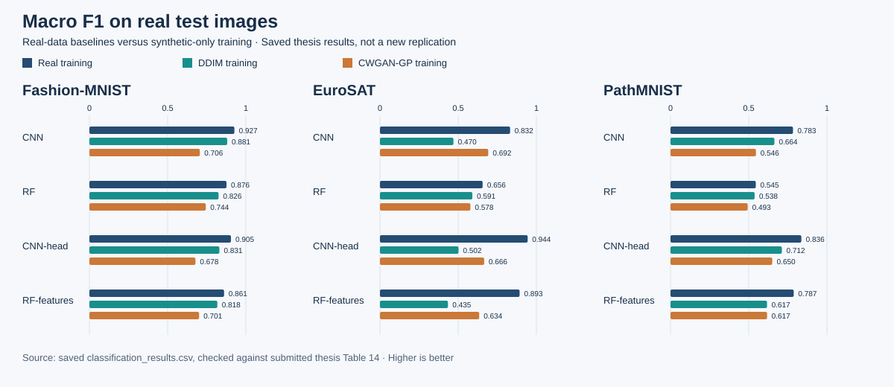
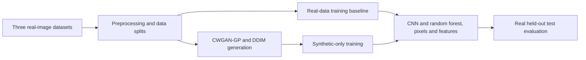

# Synthetic Image Classification Thesis

**Ozan Safak Kocak · MSc Data Science & Society · Tilburg University · 2026**

Can classifiers trained **only on synthetic images** generalize to real test images? This thesis compares **CWGAN-GP** and **DDIM** generation across **Fashion-MNIST, EuroSAT, and PathMNIST**, using CNN and random forest classifiers on pixels and MobileNetV2 features.

This repository presents the surviving research code and saved thesis results. The main collection contains **132 Jupyter notebooks and 17 Python scripts**, plus **33 distinct recovered Jupyter autosave snapshots** in a separate archive, with an experiment map to separate the main research stages from earlier trials. The result table below is copied from the saved project and was checked against Table 14 of the submitted thesis; it was not recomputed during repository preparation.

[Experiment map](docs/experiment-map.md) · [36 saved result comparisons](results/classification_results.csv) · [Environment and data setup](docs/setup.md) · [Recovered autosaves](archive/recovered-autosaves/README.md) · [Archive status](#archive-status-and-reproducibility) · [Provenance](docs/provenance.md)



## Research design

- **Generation:** class-conditional Wasserstein GAN with gradient penalty and denoising diffusion implicit models.
- **Training conditions:** real-data baselines versus training entirely on CWGAN-GP or DDIM synthetic data; evaluation uses real held-out test images.
- **Classifiers:** CNN, random forest, CNN head on frozen MobileNetV2 features, and random forest on those features.
- **Evaluation:** accuracy, macro precision/recall/F1, class-level performance, confusion matrices, and generation/feature-space analyses.



## Selected findings

CNN **macro F1 on real test images**, by training source:

| Dataset | Real training | DDIM training | CWGAN-GP training |
|---|---:|---:|---:|
| Fashion-MNIST | 0.9268 | 0.8808 | 0.7059 |
| EuroSAT | 0.8319 | 0.4699 | 0.6923 |
| PathMNIST | 0.7829 | 0.6642 | 0.5462 |

In the saved results, real-data training has higher macro F1 than either synthetic source in every classifier/dataset combination. The size of the gap varies considerably, and the stronger generator depends on the dataset: DDIM is stronger for the Fashion-MNIST CNN, while CWGAN-GP is stronger for the EuroSAT CNN. These are results of this experimental setup, not a universal ranking of generative models or evidence that synthetic images guarantee privacy.

The [full table](results/classification_results.csv) contains all 36 combinations and four metrics. The [results note](docs/results.md) explains provenance and interpretation.

## Explore the code

| Stage | Starting point |
|---|---|
| Data exploration | [`experiments/eda/`](experiments/eda/) |
| Preprocessing | [`05_preprocessing.ipynb`](experiments/05_preprocessing.ipynb) |
| CWGAN-GP EuroSAT | [`06_cgan_eurosat_seed42.py`](experiments/06_cgan_eurosat_seed42.py) |
| CWGAN-GP Fashion-MNIST | [`CGAN_8(FMNIST)`](experiments/CGAN_8%28FMNIST%29/) |
| CWGAN-GP PathMNIST | [`CGAN_9(PMNIST)`](experiments/CGAN_9%28PMNIST%29/) and [`CGAN_PMNIST_FINALS`](experiments/CGAN_PMNIST_FINALS/) |
| DDIM across the three datasets | [Generation map](docs/experiment-map.md#diffusion-experiments) |
| Pixel and feature-based classification | [`CLASSIFICATION/`](experiments/CLASSIFICATION/) |
| Feature extraction | [`FE_FE/`](experiments/FE_FE/) |
| Centroid-distance analysis | [`CENTROID/`](experiments/CENTROID/) |

The complete [experiment map](docs/experiment-map.md) explains duplicates, inspection notebooks, and exploratory variants. Original relative folder names are retained inside `experiments/`; a folder or file named “final” is not by itself proof of final-run provenance.

## Inspect locally

```sh
git clone https://github.com/oskocak-cell/synthetic-image-classification-thesis.git
cd synthetic-image-classification-thesis
python3 scripts/validate_archive.py
python3 scripts/render_results.py
```

These two commands use Python's standard library: they check the archive and regenerate the chart from the saved result table. They **do not retrain models or reproduce thesis scores**. Open the notebooks in Jupyter or a compatible environment; research execution requires datasets, compatible ML dependencies, configured paths, and potentially substantial GPU resources. See [setup](docs/setup.md).

## Archive status and reproducibility

**Some files from the original working directory were accidentally deleted before this repository was assembled.** The precise scope of the loss is unknown; deleted material may have included exploratory trials or intermediate files. This repository contains the surviving code and selected saved results, and **is not claimed to be a complete, verified snapshot of every final experiment**.

A further scan recovered 33 distinct autosave snapshots, including code whose regular notebook counterparts were not found. These are preserved separately in [`archive/recovered-autosaves/`](archive/recovered-autosaves/README.md); they may be incomplete or intermediate versions.

The main research stages are represented, but exact final-run lineage, full dependency resolution, and end-to-end reproduction of the reported results have not been verified. Trial variants and environment-specific assumptions remain documented. The archive checks validate source structure and saved-table consistency, not scientific reproducibility or model performance.

Notebook outputs and execution state were cleared, personal local/cluster path prefixes were replaced with placeholders, and algorithmic code was otherwise retained. Datasets, synthetic-image arrays, model checkpoints, feature arrays, private credentials, unrelated course materials, private planning documents, and the thesis PDF containing personal identifiers are not bundled. See [provenance and omissions](docs/provenance.md).

## Attribution

Thesis: *Evaluating Image Classification Performance of RF and CNN on Synthetic Image Data Generated by CWGAN-GP and DDIM*, Ozan Safak Kocak, Tilburg University, submitted 25 May 2026.

Dataset and method sources are linked in the [setup guide](docs/setup.md); retain their citations and applicable terms. This portfolio preserves the original research code's comments and references. No new blanket licence is asserted over third-party material. AI assistance was used in October 2026 to organize this archive, sanitize copies, prepare documentation, and add archive-validation and chart scripts; those packaging additions are separate from the thesis experiments.
